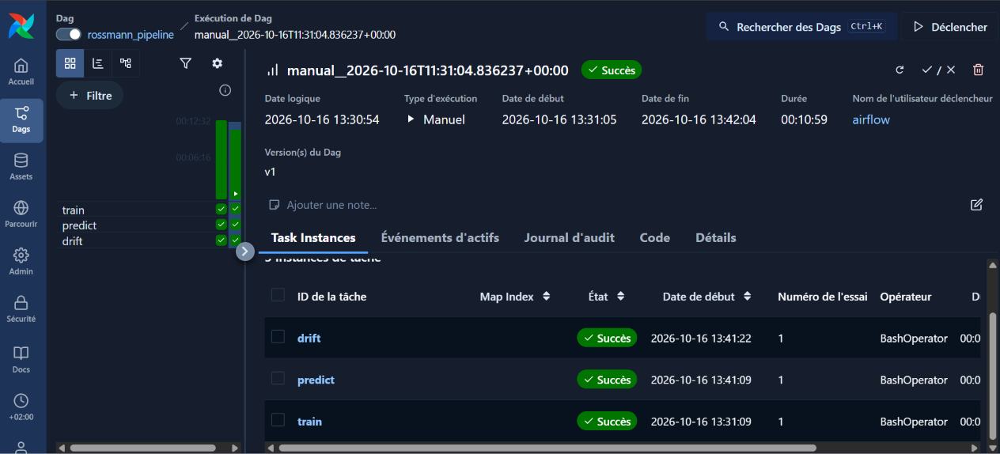

# Rossmann Store Sales


Projet de prévision des ventes quotidiennes de magasins Rossmann, à partir des données de la compétition Kaggle [Rossmann Store Sales](https://www.kaggle.com/c/rossmann-store-sales). J'ai utilisé DuckDB pour stocker et joindre les tables, LightGBM pour le modèle, MLflow pour suivre mes essais et Evidently pour surveiller la dérive des données. Le modèle est ensuite servi par une API FastAPI, emballée dans une image Docker, et le pipeline peut être lancé chaque semaine avec Airflow.

## Résultat

Je teste les modèles sur les 6 dernières semaines de l'historique (du 20 juin au 31 juillet 2015). Le modèle n'a jamais vu ces semaines pendant l'entraînement.

Le RMSPE est une erreur en pourcentage : 0,144 veut dire environ 14 % d'écart avec les ventes réelles. Avec le modèle à 1000 arbres, j'obtiens 0,144, contre 0,266 pour la prévision simple (moyenne des 4 dernières ventes du même jour de la semaine). Le modèle réduit donc l'erreur de presque moitié.

## Ce que j'ai fait

Je charge les trois fichiers CSV dans une base DuckDB et je joins `train` et `store` en SQL. Ensuite je retire les jours où le magasin est fermé, ainsi que les jours où il est ouvert mais sans aucune vente, qui ressemblent à des erreurs de saisie. Les jours fermés sont prédits à 0 à la fin.

Après quelques contrôles (doublons, valeurs manquantes, cohérence des colonnes Promo2, corrélations), je crée les variables du modèle :

- l'année, le mois, le jour et la semaine, tirés de la date ;
- le nombre de mois depuis l'ouverture du concurrent le plus proche ;
- le nombre de mois depuis le début de la dernière vague de Promo2 ;
- `StateHoliday`, `StoreType` et `Assortment` convertis en nombres ;
- des profils par magasin (niveau moyen de ventes, par jour de la semaine et selon la promo), calculés uniquement sur le passé.

Je n'utilise pas la colonne `Customers`, parce qu'on ne connaît pas le nombre de clients à l'avance.

Pour la validation, je coupe dans le temps (au 20 juin 2015) plutôt qu'au hasard : un découpage aléatoire mélangerait des jours voisins entre entraînement et test, et le score serait trop optimiste. Le modèle est entraîné sur le logarithme des ventes, puis je reviens aux vraies ventes pour les prédictions.

Je compare plusieurs versions de LightGBM, et la meilleure sur la validation est réentraînée sur tout l'historique pour prédire `test.csv`. Chaque essai (baseline, versions de LightGBM, modèle final, prédictions) est enregistré dans MLflow. Le fichier de sortie garde toutes les lignes de `test.csv`.

## Surveillance de la dérive des données

Avec Evidently, je compare les données d'entraînement et celles de `test.csv`, colonne par colonne, pour voir si elles se ressemblent. Les colonnes tirées de la date (`Year`, `Month`, `Day`, `WeekOfYear`) dérivent presque forcément, puisque le test couvre une autre période. Je produis donc deux rapports HTML : un complet, et un sans ces colonnes.

## API de prévision

Le modèle sauvegardé est exposé par une API FastAPI (`src/projet_home/api.py`). Elle reprend exactement les mêmes transformations que l'entraînement, donc les prévisions ne peuvent pas diverger du pipeline.


Un magasin fermé (`Open = 0`) est prédit à 0. Un magasin inconnu, un `StateHoliday` invalide ou une liste vide renvoient une erreur 422.

L'API charge le modèle et `store.csv` au démarrage : il faut donc avoir lancé `train` avant.

```bash
uv run uvicorn projet_home.api:app --reload
```

La documentation interactive est sur http://127.0.0.1:8000/docs. Exemple de requête :

```json
{"rows": [{"Store": 1, "Date": "2015-08-03", "Promo": 1}]}
```

## Docker

Le `Dockerfile` à la racine emballe l'API : Python 3.13, `uv`, les dépendances du projet, le modèle sauvegardé (`models/`) et `store.csv`. Il faut donc avoir lancé `train` avant de construire l'image. Si on réentraîne, il faut reconstruire l'image.

```bash
docker build -t rossmann-api .
docker run -p 8000:8000 rossmann-api
```

L'API est alors accessible sur http://localhost:8000/docs.

## Automatisation avec Airflow

Le dossier `airflow/` contient une installation d'Airflow lancée avec Docker Compose (version 3.3.2) et un DAG, `rossmann_pipeline`, qui enchaîne les trois scripts :

```
train  ->  predict  ->  drift
```

Le DAG est planifié chaque semaine (`@weekly`), relance une tâche une fois en cas d'échec et ne rattrape pas les semaines manquées. Chaque tâche lance un module du projet avec `uv run`, dans un environnement séparé de celui d'Airflow, pour éviter les conflits de paquets.

| Fichier | Rôle |
|---|---|
| `airflow/docker-compose.yaml` | fichier officiel d'Airflow |
| `airflow/Dockerfile` | image du worker : ajoute `uv` et la bibliothèque système de LightGBM |
| `airflow/docker-compose.override.yaml` | partage le dossier du projet avec le worker |
| `airflow/dags/rossmann_pipeline.py` | le DAG |

Depuis le dossier `airflow/` :

```bash
docker compose build airflow-worker
docker compose up airflow-init
docker compose up -d
```

L'interface est sur http://localhost:8080 (identifiant `airflow`, mot de passe `airflow`). On y active `rossmann_pipeline`, puis on le lance avec le bouton de déclenchement. Le premier lancement est long, car `uv` installe les paquets du projet dans le conteneur.



## Organisation du dépôt

```
data/raw/             
Notebooks/
    rossmann.ipynb     
src/projet_home/       
tests/                 
airflow/               
.github/workflows/     
Dockerfile             
.dockerignore
pyproject.toml
uv.lock
```

Les données, la base DuckDB, la base MLflow, les modèles sauvegardés, les rapports et les journaux d'Airflow ne sont pas dans le dépôt (voir `.gitignore`).

## Lancer le projet

J'utilise [uv](https://docs.astral.sh/uv/) avec Python 3.13.

```bash
git clone https://github.com/farnounef/rossmann-forecast.git
cd rossmann-forecast
uv sync
```

Les données sont à télécharger sur la [page Kaggle de la compétition](https://www.kaggle.com/c/rossmann-store-sales/data) et à placer dans `data/raw/`.

Le plus simple est d'exécuter `Notebooks/rossmann.ipynb`, qui produit un fichier `submission.csv`. Le même pipeline existe aussi en scripts, à lancer depuis la racine du projet dans cet ordre :

```bash
uv run python -m projet_home.train
uv run python -m projet_home.predict
uv run python -m projet_home.drift
```

`train` compare les modèles et sauvegarde le meilleur, `predict` crée `submission.csv`, et `drift` écrit les rapports Evidently dans `reports/`.

Pour voir les essais dans MLflow, depuis la racine du projet :

```bash
uv run mlflow ui --backend-store-uri sqlite:///mlflow.db
```

L'interface est alors sur http://localhost:5000, dans l'expérience `rossmann`.

## Tests et intégration continue

```bash
uv run pytest
```

Les tests vérifient la création des variables, la métrique, la coupure dans le temps, la baseline, les profils par magasin et l'API (avec un faux modèle, sans fichier de données). Ils tournent aussi automatiquement sur GitHub à chaque `push`, avec GitHub Actions.